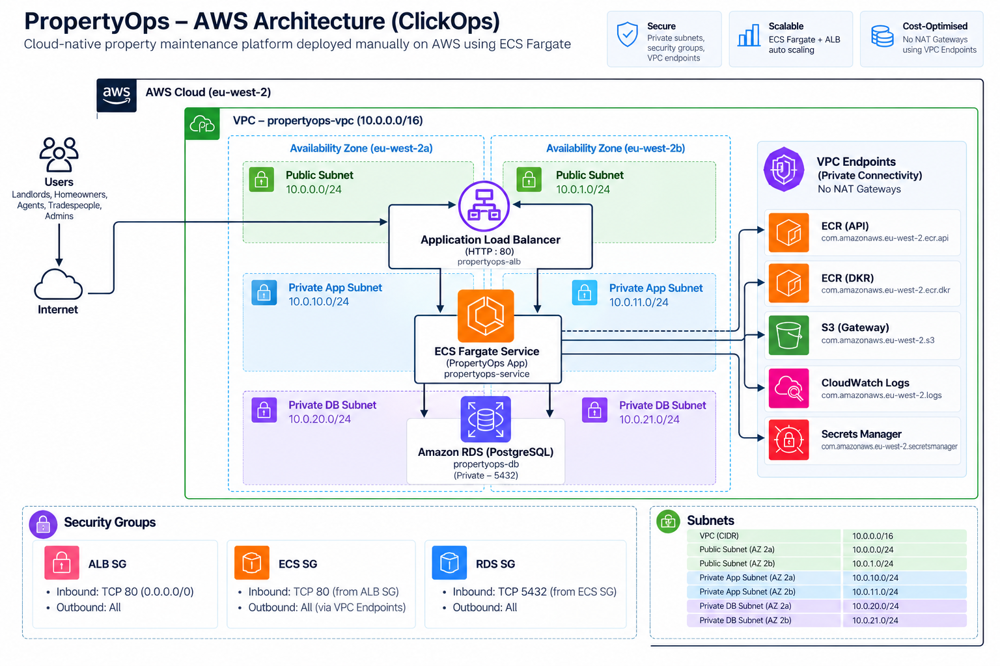

# PropertyOps — AWS ECS Fargate ClickOps Platform

PropertyOps is a cloud-native property maintenance platform deployed manually on AWS to demonstrate practical understanding of containerised workloads, networking, security, databases, monitoring and scalability.

This repository documents the **ClickOps implementation** of the platform. The infrastructure was built manually through the AWS Management Console before being recreated separately using Terraform.

---
## Architecture Diagram



---

## Project Overview

PropertyOps represents a property maintenance platform where landlords, property managers, tenants and tradespeople could interact with maintenance jobs.

The application itself is intentionally lightweight. The primary focus of this project is the AWS infrastructure and DevOps architecture supporting the workload.

The platform was deployed using:

- Amazon ECS with AWS Fargate
- Amazon ECR
- Application Load Balancer
- Amazon RDS PostgreSQL
- AWS Secrets Manager
- Amazon S3
- Amazon CloudWatch
- Amazon SNS
- ECS Service Auto Scaling
- AWS VPC Endpoints
- Multi-AZ networking

---

## Architecture

The environment was deployed in:

`eu-west-2 — Europe (London)`

The VPC used the CIDR:

`10.0.0.0/16`

The network was divided into six subnets across two Availability Zones.

| Tier | Availability Zone | CIDR |
|---|---|---|
| Public | eu-west-2a | `10.0.0.0/24` |
| Public | eu-west-2b | `10.0.1.0/24` |
| Private Application | eu-west-2a | `10.0.10.0/24` |
| Private Application | eu-west-2b | `10.0.11.0/24` |
| Private Database | eu-west-2a | `10.0.20.0/24` |
| Private Database | eu-west-2b | `10.0.21.0/24` |

The Application Load Balancer was deployed in the public subnets.

ECS Fargate tasks were deployed into the private application subnets.

Amazon RDS PostgreSQL was deployed into private database subnets.

---

## Network Design

The architecture uses separate network tiers to reduce unnecessary exposure.

```text
Internet
   |
   v
Application Load Balancer
   |
   v
ECS Fargate Tasks
   |
   +--------------------+
   |                    |
   v                    v
RDS PostgreSQL     AWS VPC Endpoints
                        |
          +-------------+-------------+
          |             |             |
         ECR       CloudWatch      Secrets